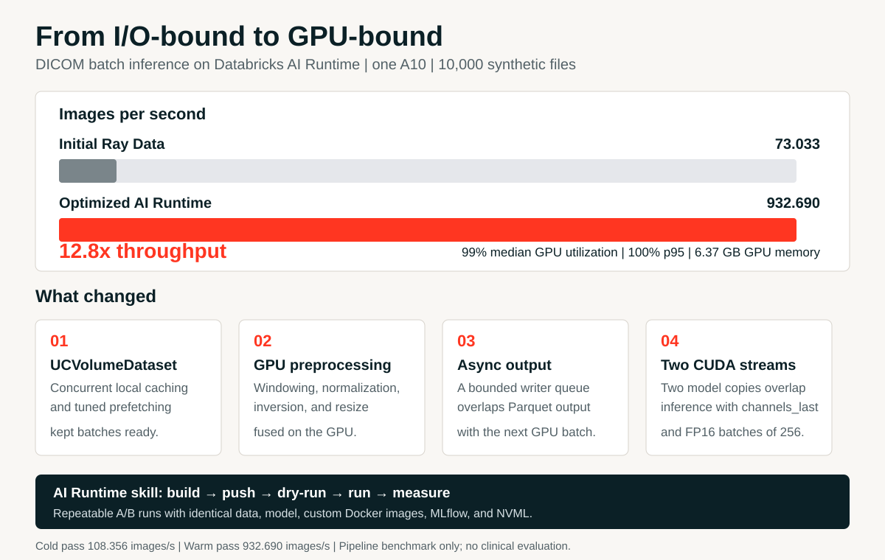

# Chest X-ray DICOM batch inference with TorchXRayVision

This recipe uses `UCVolumeDataset` and a custom AI Runtime image to run research-only batch inference on single-frame chest X-ray DICOM files with [TorchXRayVision](https://github.com/mlmed/torchxrayvision)'s [`densenet121-res224-all`](https://github.com/mlmed/torchxrayvision/releases/tag/v1) model on one A10 GPU. It accepts `DX` and `CR` images and writes one row of uncalibrated pathology scores per image.

The scores are not diagnoses, calibrated probabilities, or triage decisions. Do not use this recipe for clinical care. Research use requires separate validation on the intended scanner, protocol, site, and patient population.

## From 73 to 932 images/s

The same 10,000 synthetic DICOM files and TorchXRayVision model were used for both measurements on one A10. The initial Ray Data implementation read many small files and preprocessed them on CPU; the optimized AI Runtime pipeline removed those bottlenecks instead of changing the model. Reproduce the validation files with [`assets/prepare_synthetic.py`](assets/prepare_synthetic.py).

| Implementation | Throughput | What limited or enabled it |
|---|---:|---|
| Initial Ray Data batch inference | 73.033 images/s | Small-file I/O, CPU preprocessing, and fragmented batches left the GPU waiting. |
| Optimized AI Runtime pipeline | 932.690 images/s | Concurrent caching and prefetching, fused GPU preprocessing, two CUDA streams, and asynchronous Parquet writes. |

The optimized warm pass recorded **99% median** and **100% p95 GPU utilization**, using **6.37 GB** of GPU memory. Mean utilization was **63.09%** because startup and end-of-run idle windows are included. The final cold pass measured **108.356 images/s**; warmup is a way to isolate steady-state performance, not a requirement for production.



AI Runtime also supports [Ray Data batch inference](https://docs.databricks.com/aws/en/machine-learning/ai-runtime/examples/gpu-batch-inference). Ray was not the fundamental bottleneck here: file layout and scheduling were. This optimized recipe uses the direct [`UCVolumeDataset`](https://docs.databricks.com/aws/en/machine-learning/ai-runtime/develop-workloads/dataloading) path for small DICOM files; Ray Data remains useful for distributed actor pipelines.

The **Databricks AI Runtime skill** (`databricks-ai-runtime`) made the optimization loop repeatable: build a custom `linux/amd64` Docker image, push it to Databricks Artifact Registry, dry-run and override workloads, then compare identical runs using MLflow throughput and NVML utilization metrics. Custom images kept the framework, DICOM codecs, AIR DataLoader, OpenCV, and model weights consistent across every test.

### References

- [AI Runtime data loading and `UCVolumeDataset`](https://docs.databricks.com/aws/en/machine-learning/ai-runtime/develop-workloads/dataloading)
- [AI Runtime custom Docker images](https://docs.databricks.com/aws/en/machine-learning/ai-runtime/cli/docker-images)
- [AI Runtime Ray Data batch inference](https://docs.databricks.com/aws/en/machine-learning/ai-runtime/examples/gpu-batch-inference)
- [Fast, fault-tolerant PyTorch training on AI Runtime — Databricks Engineering Blog](https://www.databricks.com/blog/fast-fault-tolerant-pytorch-training-ai-runtime)

## Before you run

### Build and push the custom image

Enable the AI Runtime Beta Features and Databricks Artifact Registry previews, and install Docker. Use Databricks CLI 1.20.0 or newer and a Unity Catalog schema where you have permission to push images. This example uses `main.default`.

From this recipe directory, build for `linux/amd64` and push the image:

```bash
docker build --platform linux/amd64 -t dicom-xray-inference:8 .
databricks air images push --profile <profile> \
  --source dicom-xray-inference:8 \
  --catalog main --schema default --artifact dicom-xray-inference:8
```

The image contains PyTorch, AIR's volume DataLoader, pydicom, common JPEG/JPEG-LS/JPEG 2000 decoders, OpenCV, and cached public TorchXRayVision weights. For Azure, build with `--build-arg BASE_IMAGE=databricksruntime/air:dcs-base-azure-runtime`.

The push command creates `main.default.dicom-xray-inference:8`. To use another catalog or schema, change the push command and `environment.unity_catalog_image` in `workload.yaml` to match.

### Add input images

Upload de-identified `.dcm` or `.DCM` files to the directory configured as `INPUT_PATH`. The default is:

```text
/Volumes/main/default/air_examples/dicom-batch-inference-torchxrayvision/input
```

The volume must already exist and be accessible. Inputs must be single-frame, grayscale `DX` or `CR` images; compressed pixel data is supported through the bundled pydicom plugins. An unreadable or unsupported DICOM file fails the run with its input path in the error. The default `OUTPUT_ROOT` is a sibling `predictions` directory on the same volume. Change either path in `workload.yaml` as needed.

Use data de-identified according to your organization's policies. Removing DICOM tags does not remove burned-in PHI from pixel data. The recipe does not copy `PatientName` or `PatientID` to its output, but DICOM UIDs and device metadata remain sensitive.

Set `MAX_IMAGES` in `workload.yaml` to a small positive integer for a single-process smoke test. The default value `0` processes every matching file with concurrent caching and decoding. `BATCH_SIZE` defaults to 256, `DATALOADER_WORKERS` to 12, and `PREFETCH_FACTOR` to 32. `USE_AMP` enables mixed-precision inference. Standard linear DICOM windowing, normalization, and resizing run in batches on the GPU; non-linear LUTs and mixed-size batches fall back to CPU preprocessing. Two independent CUDA streams and a bounded asynchronous Parquet writer keep output work off the GPU's critical path. `CHANNELS_LAST` is enabled for Tensor Core convolution.

## Run

```bash
databricks air run -f workload.yaml --profile <profile>
```

## Results

Each run writes `predictions.parquet` to `OUTPUT_ROOT/<MLFLOW_RUN_ID>`. Rows contain the SOP, study, and series instance UIDs, modality and device metadata, original image dimensions, the model weight identifier, and one `score_*` column for each TorchXRayVision output. Join results back to source images with `sop_instance_uid`.

The AIR MLflow run records the image count, inference wall time, and throughput. Set `WARMUP_PASS=true` to run one warmup pass without writing predictions, then record separate cold and warm metrics. `INFERENCE_REPEATS` controls how many measured passes run; the final pass overwrites the previous Parquet output and metrics. On 10,000 synthetic 512x512 DICOM images on one A10, the best validation measured 108.356 images/s on the cold pass and 932.690 images/s on the warm pass. The warm pass used 6.37 GB of GPU memory and recorded 99% median and 100% p95 GPU utilization. These are pipeline measurements, not clinical performance results.
