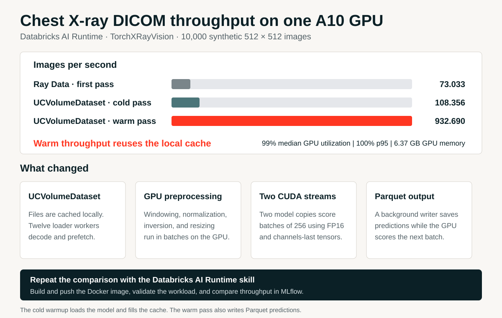

# Chest X-ray DICOM batch inference with TorchXRayVision

This recipe runs batch inference on single-frame chest X-ray DICOM files. It uses `UCVolumeDataset` and a custom AI Runtime image on one A10 GPU. Inference uses [TorchXRayVision](https://github.com/mlmed/torchxrayvision)'s [`densenet121-res224-all`](https://github.com/mlmed/torchxrayvision/releases/tag/v1) model. The recipe accepts `DX` and `CR` images and writes one row of uncalibrated pathology scores per image.

You can use and adapt this recipe for research and evaluation. The scores are not diagnoses, calibrated probabilities, or triage decisions. Do not use them for clinical care. Validate the full workflow separately for the intended scanner, protocol, site, and patient population.

## Improving DICOM throughput from 73 to 932 images/s

Small-file I/O and CPU preprocessing limited the initial Ray Data implementation. The GPU often waited for input instead of running inference. The optimized AI Runtime pipeline removed those bottlenecks without changing the model.

Both implementations processed the same 10,000 synthetic DICOM files with the same TorchXRayVision model on one A10. Reproduce the validation files with [`assets/prepare_synthetic.py`](assets/prepare_synthetic.py).

| Implementation | Throughput | What limited or enabled it |
|---|---:|---|
| Initial Ray Data batch inference | 73.033 images/s | Small-file I/O, CPU preprocessing, and fragmented batches left the GPU waiting. |
| Optimized AI Runtime pipeline | 932.690 images/s | Concurrent caching and prefetching, fused GPU preprocessing, two CUDA streams, and asynchronous Parquet writes. |

The optimized warm pass used **6.37 GB** of GPU memory. It recorded **99% median** and **100% p95 GPU utilization**. Mean utilization was **63.09%** because startup and end-of-run idle windows are included.

The final cold pass measured **108.356 images/s**. Warmup isolates steady-state performance; it is not required for production.



**Alternatives considered:** AI Runtime also supports [Ray Data batch inference](https://docs.databricks.com/aws/en/machine-learning/ai-runtime/examples/gpu-batch-inference). Ray was not the fundamental bottleneck here; file layout and scheduling were. This recipe uses the direct [`UCVolumeDataset`](https://docs.databricks.com/aws/en/machine-learning/ai-runtime/develop-workloads/dataloading) path for small DICOM files. Ray Data remains useful for distributed actor pipelines.

Use the **Databricks AI Runtime skill** (`databricks-ai-runtime`) to repeat the optimization loop. It standardizes custom-image builds, workload validation, and MLflow performance comparisons.

### References

- [AI Runtime data loading and `UCVolumeDataset`](https://docs.databricks.com/aws/en/machine-learning/ai-runtime/develop-workloads/dataloading)
- [AI Runtime custom Docker images](https://docs.databricks.com/aws/en/machine-learning/ai-runtime/cli/docker-images)
- [AI Runtime Ray Data batch inference](https://docs.databricks.com/aws/en/machine-learning/ai-runtime/examples/gpu-batch-inference)
- [Fast, fault-tolerant PyTorch training on AI Runtime — Databricks Engineering Blog](https://www.databricks.com/blog/fast-fault-tolerant-pytorch-training-ai-runtime)

## Before you run

### Build and push the custom image

Enable the AI Runtime Beta Features and Databricks Artifact Registry previews. Install Docker and Databricks CLI 1.20.0 or newer. Use a Unity Catalog schema where you have permission to push images. This example uses `main.default`.

From this recipe directory, build for `linux/amd64` and push the image:

```bash
docker build --platform linux/amd64 -t dicom-xray-inference:8 .
databricks air images push --profile <profile> \
  --source dicom-xray-inference:8 \
  --catalog main --schema default --artifact dicom-xray-inference:8
```

The image includes PyTorch, AIR's volume DataLoader, pydicom, OpenCV, and common DICOM decoders. It also caches the public TorchXRayVision weights. For Azure, build with `--build-arg BASE_IMAGE=databricksruntime/air:dcs-base-azure-runtime`.

The push command creates `main.default.dicom-xray-inference:8`. To use another catalog or schema, change the push command and `environment.unity_catalog_image` in `workload.yaml` to match.

### Add input images

Upload de-identified `.dcm` or `.DCM` files to the directory configured as `INPUT_PATH`. The default is:

```text
/Volumes/main/default/air_examples/dicom-batch-inference-torchxrayvision/input
```

The volume must already exist and be accessible. Inputs must be single-frame, grayscale `DX` or `CR` images. The bundled pydicom plugins support compressed pixel data. An unreadable or unsupported file fails the run and reports its input path.

The default `OUTPUT_ROOT` is a sibling `predictions` directory on the same volume. Change either path in `workload.yaml` as needed.

Use data de-identified according to your organization's policies. Removing DICOM tags does not remove burned-in PHI from pixel data. The recipe does not copy `PatientName` or `PatientID` to its output. DICOM UIDs and device metadata remain sensitive.

Set `MAX_IMAGES` to a small positive integer for a single-process smoke test. The default value `0` processes every matching file with concurrent caching and decoding.

`BATCH_SIZE` defaults to 256, `DATALOADER_WORKERS` to 12, and `PREFETCH_FACTOR` to 32. `USE_AMP` enables mixed-precision inference. `CHANNELS_LAST` enables Tensor Core convolution.

Standard linear DICOM windowing, normalization, and resizing run in batches on the GPU. Non-linear LUTs are applied on the CPU. Mixed-size images are grouped by shape for GPU preprocessing. Two independent CUDA streams overlap inference. A bounded asynchronous Parquet writer keeps output work off the GPU's critical path.

## Run

```bash
databricks air run -f workload.yaml --profile <profile>
```

## Results

Each run writes `predictions.parquet` to `OUTPUT_ROOT/<MLFLOW_RUN_ID>`. Rows contain DICOM UIDs, modality and device metadata, original image dimensions, and the model weight identifier. Each TorchXRayVision output has one `score_*` column. Join results back to source images with `sop_instance_uid`.

The AIR MLflow run records the image count, inference wall time, and throughput. Set `WARMUP_PASS=true` to run one warmup pass without writing predictions. The run then records separate cold and warm metrics.

`INFERENCE_REPEATS` controls how many measured passes run. The final pass overwrites the previous Parquet output and metrics. These are pipeline measurements, not clinical performance results.
